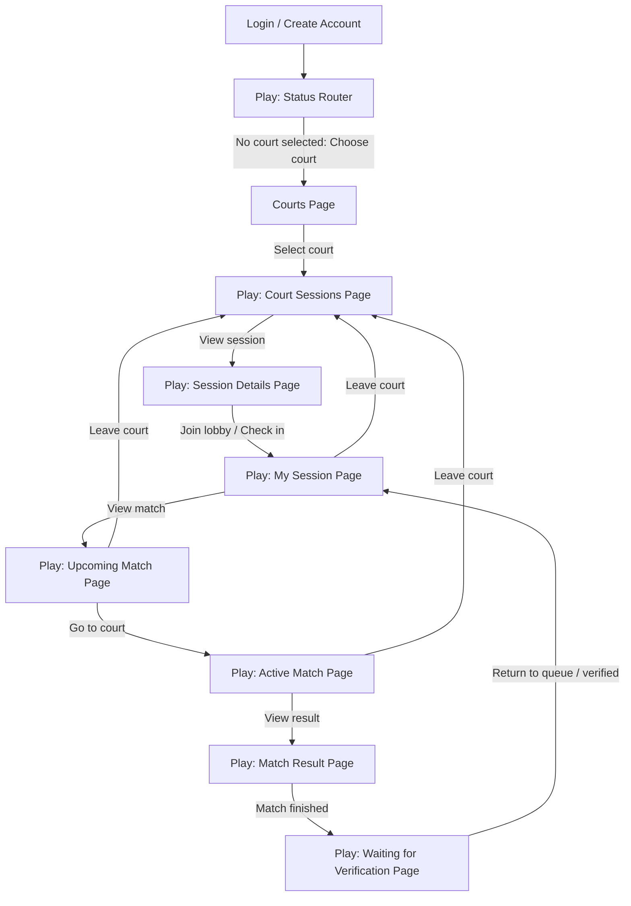

# LORD AI CONTEXT HANDOFF

This handoff summarizes the current project state for the next AI/coder. Do not put secrets, database passwords, Supabase service-role keys, or user credentials in committed files.

## Current Branch Context

- Working branch requested by user: `Dev_Meeperer`
- Base branch before this handoff: `dev`
- Repository: `micosayson/Pickleball-Project`
- Local workspace: `G:\PickleProject\Pickleball-Project`
- Shell requirement from user: use PowerShell native commands only. Do not open Git Bash, Git CMD, mintty, Git GUI, or visible terminal windows.

## Product Direction

The app is a court-based pickleball platform. The key player workflow is:

1. User logs in.
2. User chooses a court.
3. User sees sessions/events for that court.
4. User opens session details.
5. User joins the lobby/checks in.
6. Checked-in user enters the queue.
7. System finds balanced players.
8. Upcoming match is shown.
9. User goes to court.
10. Match is played.
11. User taps `Match finished`.
12. Queue master verifies.
13. Player returns to queue.
14. Flow repeats until player leaves court.

## Refined Flowchart



## Flutter Page Separation

The Play workflow has been split out of `home_placeholder_page.dart` into part files under:

```text
frontend/lib/features/home/pages/play/
  play_flow_page.dart
  play_status_page.dart
  court_sessions_page.dart
  session_details_page.dart
  my_session_page.dart
  upcoming_match_page.dart
  active_match_page.dart
  match_result_page.dart
  waiting_verification_page.dart
```

`home_placeholder_page.dart` still owns:

- app shell
- bottom navigation
- auth sign-out button
- current Play workflow state
- court/session active state
- shared UI helper widgets used by the part files
- Settings/Profile/Courts tab scaffolding

## Current Frontend Behavior

Implemented:

- Supabase auth flow.
- Signed-in bottom navigation: `Play`, `Courts`, `Profile`, `Settings`.
- Court selection.
- Court-scoped sessions list.
- Session details page.
- Real backend call for `Join lobby` / event check-in.
- Full-page UI states for:
  - Play status
  - Court sessions
  - Session details
  - My session / queue
  - Upcoming match
  - Active match
  - Match result
  - Waiting for verification
- Settings tab contains build readiness and live API checks.

Prototype/simulated after check-in:

- Upcoming match assignment.
- Team/player/rating data.
- Active match state.
- `Match finished` confirmation.
- Waiting verification.
- Return to queue.

These need backend services before becoming real data-driven states.

## Backend Status

Implemented or scaffolded:

- SQLAlchemy models for core pickleball domain.
- Alembic migrations.
- Supabase Auth validation.
- User profile sync.
- Courts and court memberships.
- Events and event registrations.
- Event check-in endpoint.
- Route scaffolding for matches, ratings, rankings, and score submissions.
- Demo seed data.

Still needed:

- Persistent queue table/service.
- Leave court endpoint that removes player from queue.
- Automatic matchmaking service.
- Match lifecycle service.
- Queue master verification service.
- Rating/ranking updates after verified match results.
- Integration tests covering the full player flow.

## Important Implementation Notes

- Do not commit `.env` files or secrets.
- The Flutter client must use the Supabase publishable/anon key only.
- Never put the Supabase service-role key in Flutter.
- Android emulator reaches host backend through `http://10.0.2.2:8000/api/v1`.
- Current backend was previously run with uvicorn on `127.0.0.1:8000`.
- Use `D:\Tools\flutter\bin\flutter.bat` and `D:\Tools\flutter\bin\dart.bat` when Flutter/Dart are not on PATH.
- Set `JAVA_HOME` to `D:\Tools\jdk-21` for APK builds if needed.

## Verification Commands

Run from `frontend/`:

```powershell
D:\Tools\flutter\bin\flutter.bat analyze
D:\Tools\flutter\bin\flutter.bat test
```

Debug APK build for emulator:

```powershell
$env:JAVA_HOME='D:\Tools\jdk-21'
$env:Path="$env:JAVA_HOME\bin;$env:Path"
D:\Tools\flutter\bin\flutter.bat build apk --debug --dart-define=BACKEND_BASE_URL=http://10.0.2.2:8000/api/v1
```

Install APK:

```powershell
D:\Tools\Android\Sdk\platform-tools\adb.exe install -r frontend\build\app\outputs\flutter-apk\app-debug.apk
```

## Recommended Next Work

1. Add persistent queue backend support.
2. Wire `Leave court` to a backend endpoint.
3. Replace prototype match data in Flutter with live upcoming-match API data.
4. Add queue master verification UI/API.
5. Connect verified match results to ratings and rankings.
6. Add integration tests per full flow step.

## Recent Relevant Commits

- `bef6df5` - added prototype session/match flow.
- `6202df5` - split Play workflow into full-page UI states.
- `74e796f` - separated Play workflow pages into files under `pages/play/`.
