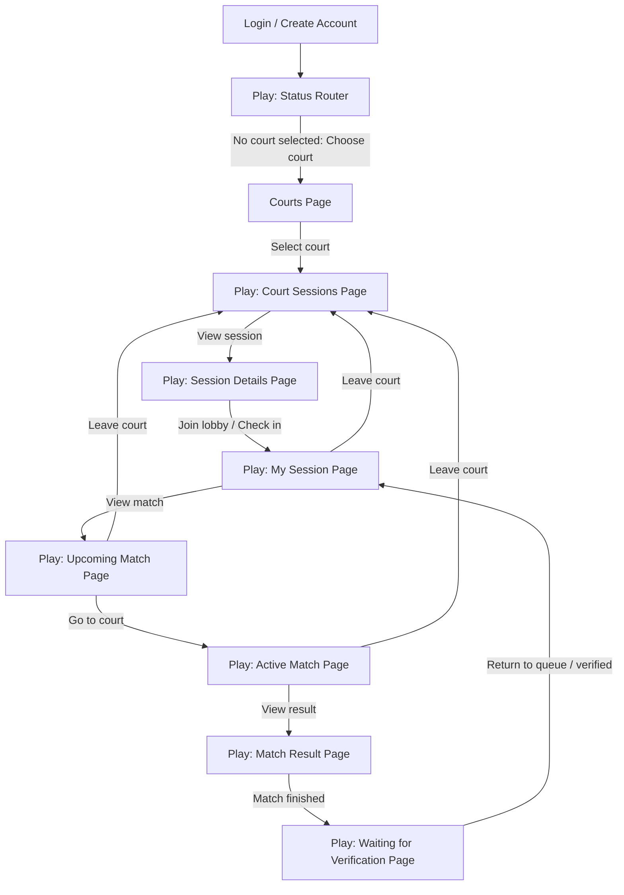

# Pickleball Platform

Multi-tenant pickleball platform monorepo for court-based events, lobby check-in,
automatic match queueing, match completion, ratings, and rankings.

## Repository Layout

```text
Pickleball-Project/
  backend/
    app/
    alembic/
    scripts/
    pyproject.toml
  frontend/
    lib/
      features/
        auth/
        courts/
        events/
        home/
  docs/
    handoff.md
    permission_matrix.md
    roadmap.md
  README.md
```

## Product Vision

The platform is player-first.

- Players discover courts and court-specific sessions.
- Players check in to a session lobby when they arrive at court.
- Checked-in players enter an automatic matchmaking queue.
- The system creates balanced matches and notifies players.
- Players mark matches finished.
- Queue masters verify results.
- Verified results update ratings and rankings.
- Players return to the queue after verification.

## Tech Stack

- Frontend: Flutter mobile/web
- Backend: FastAPI
- ORM: SQLAlchemy 2.0
- Migrations: Alembic
- Database: Supabase PostgreSQL
- Auth: Supabase Auth
- Storage: Supabase Storage

## Architecture Principles

- Business logic belongs in FastAPI services.
- Supabase is infrastructure only: auth, database hosting, and storage.
- Tenant-owned records must remain tenant-scoped.
- Competitive workflows must be auditable and deterministic.
- Match outcomes drive ratings, and ratings drive rankings.
- The Flutter app should show one main user decision per page.

## Current User Workflow

The current ideal player workflow is:



## Page Separation

The signed-in Flutter experience uses bottom navigation for top-level areas:

- `Play`
- `Courts`
- `Profile`
- `Settings`

The Play tab is separated into full-page workflow states under:

```text
frontend/lib/features/home/pages/play/
  play_flow_page.dart
  play_status_page.dart
  court_sessions_page.dart
  session_details_page.dart
  my_session_page.dart
  upcoming_match_page.dart
  active_match_page.dart
  match_result_page.dart
  waiting_verification_page.dart
```

### Play Pages

| Page | Main job | Primary action | Secondary action |
|---|---|---|---|
| `PlayStatusPage` | Route the user to the next correct play step | `Choose court`, `View sessions`, or `View my session` | none |
| `CourtSessionsPage` | Show sessions for the selected court | `View session` | `Change court` |
| `SessionDetailsPage` | Confirm the session before check-in | `Join lobby` | back to sessions |
| `MySessionPage` | Show checked-in queue status | `View match` | `Leave court` |
| `UpcomingMatchPage` | Show match assignment and teams | `Go to court` | `Leave court` |
| `ActiveMatchPage` | Show the active match state | `View result` | `Leave court` |
| `MatchResultPage` | Confirm match completion | `Match finished` | none |
| `WaitingVerificationPage` | Show queue master verification state | `Return to queue` | none |

## Current Backend Status

Working pieces:

- SQLAlchemy models for users, courts, events, matches, ratings, rankings, and history tables.
- Alembic migration flow.
- Supabase connection through backend configuration.
- Supabase Auth validation through FastAPI.
- Tenant-aware request handling through court headers for court-scoped event reads.
- Court membership selection.
- Event registration/check-in endpoint for lobby entry.
- Event, match, rating, ranking, and score route scaffolding.
- Demo seed data including `Thursday Competitive Play`.

Still in progress:

- Real automatic matchmaking service.
- Real queue persistence and queue list adjustment.
- Queue master verification workflow.
- Match lifecycle transitions beyond the current UI prototype.
- Rating/ranking updates from verified results.
- Production permission guards for admin/queue-master operations.
- Broader CRUD and integration test coverage.

## Current Frontend Status

Working pieces:

- Supabase Auth login and sign-up flow.
- `AuthGate` for logged-in/logged-out routing.
- Signed-in app shell with bottom navigation.
- Court selection and court-scoped session list.
- Session details page.
- Lobby check-in using the backend event check-in endpoint.
- Full-page Play workflow states for queue, upcoming match, active match, result, and waiting verification.
- Settings tab with build readiness and live API checks.

Important note:

- The UI after check-in currently models the ideal flow. The actual backend check-in call is real, but upcoming match generation, active match state, match finished verification, and return-to-queue are still frontend workflow states until backend queue/matchmaking services are completed.

## Environment Notes

- Keep secrets in `backend/.env` or local environment variables.
- Do not commit Supabase passwords or service role keys.
- Use the backend virtual environment for local backend development.
- On Android emulator, the Flutter app should use `10.0.2.2` to reach a backend running on the host machine.

Example backend Python:

```powershell
backend\.venv\Scripts\python.exe
```

Example Flutter debug APK build for emulator:

```powershell
D:\Tools\flutter\bin\flutter.bat build apk --debug --dart-define=BACKEND_BASE_URL=http://10.0.2.2:8000/api/v1
```

## Useful Commands

Run from `backend/`:

```powershell
python -m alembic upgrade head
python scripts/seed_demo.py
```

Run from `frontend/`:

```powershell
D:\Tools\flutter\bin\flutter.bat analyze
D:\Tools\flutter\bin\flutter.bat test
```

## Docs

- [Handoff](docs/handoff.md)
- [Roadmap](docs/roadmap.md)
- [Permission Matrix](docs/permission_matrix.md)

## Next Steps

1. Persist queue entries when a player checks in.
2. Add `Leave court` backend support that removes the player from the queue and adjusts queue order.
3. Build automatic matchmaking from checked-in queued players.
4. Add queue master match verification.
5. Connect verified results to rating and ranking updates.
6. Replace prototype match data in Flutter with live match assignments.
7. Add integration tests for court selection, check-in, queue, match generation, verification, and return-to-queue.
